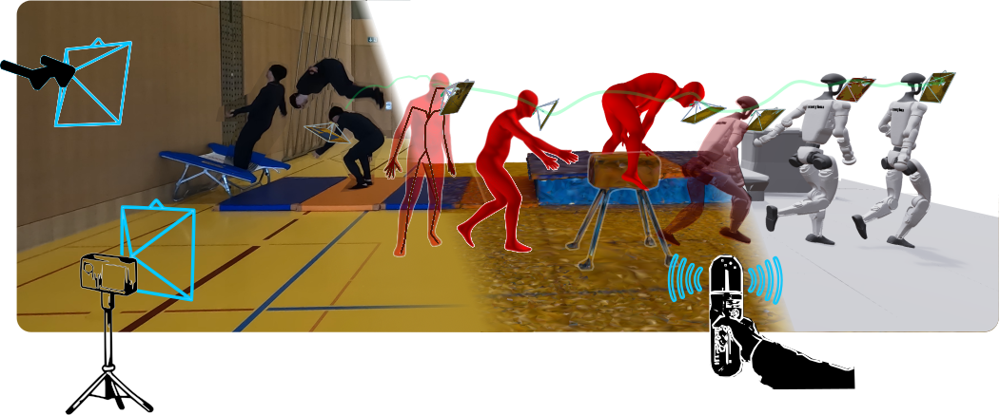
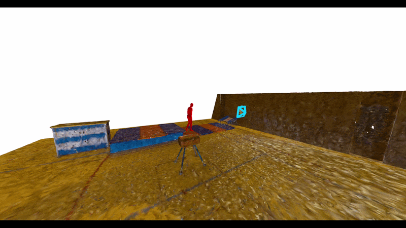
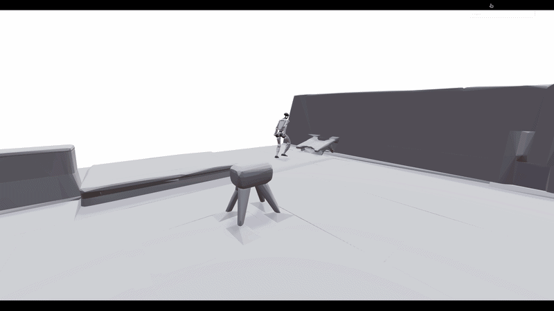

## EgoHTG: Egocentric 4D Demonstrations of Human Terrain Traversal

<!-- Badges: arxiv, webpage, huggingface, data -->
<p align="center">
	<a href="https://arxiv.org/abs/2607.13472"></a>
	<a href="https://egohtr.github.io/"></a>
	<a href="https://huggingface.co/datasets/leggedrobotics/egohtr"></a>
	<a href="https://drive.google.com/drive/folders/1gOVfAErGnjoge6vo7_T9qLkv765HWhCX?usp=drive_link"></a>
</p>
<p align="center">
  <a href="data/assets/method_01.png"></a>
</p>

This repository implements the **Egocentric Human-Terrain Generation (EgoHTG)** pipeline. EgoHTG ...
- Ingests multi-sensor data (Project Aria, egocentric mocap, scene scan).
- Generates an aligned SMPL-X body model sequence with a high resolution 3D scan. 
- Visualizes with the [Rerun](https://www.rerun.io/) viewer.
- Retargets motion to robot embodiments.

The project is organized as a modular pipeline, splitted into generation, optimization, retargeting, evaluation, visualization.

---

## News & Updates

- [X] **29.10.2026**: Release G1 retargeted motion sequences
- [x] **01.10.2026**: Release Hugging Face Repo with complete data sources with raw data.
- [x] **06.04.2026**: Inital code release and access to generated sequence files.


## Installation


1. **Clone the repository** (using the appropriate method for your environment).

2. **Create and activate a virtual environment** (recommended):

Make sure to run the setup with Python 3.11.

```bash
cd human_terrain_generation
python -m venv .venv
source .venv/bin/activate  # Linux/macOS
```

3. **Install Python dependencies** for the main pipeline:

```bash
pip install --upgrade pip
pip install -r requirements.txt
```

4. **Update submodules**:
```bash
git submodule update --init --recursive
pip install -e ./external/GMR
```

5. **Download SMPL-X models** [here](https://smpl-x.is.tue.mpg.de/) and place them under `data/models/smplx_models/smplx/`.

6. **Optional**: In case a new sequence and scene is added, create an additional venv at `"../venv/vggt` and install 
```bash
pip install -r requirements_vggt.txt
```
It will be needed for the synchronisation of the sensors.

## Run the demo sequence

The main entry point is `scripts/generate.py`, which wires up `PipelineConfig` and `EgoHTGPipeline`.

1. **Download Demo Data sequene** [here](https://drive.google.com/drive/folders/1gOVfAErGnjoge6vo7_T9qLkv765HWhCX?usp=sharing) and place it under `data/sequences/`

2. **Visualize Demo sequence**

```bash
python -m scripts.generate --sequence parkour_s1_gym_04 --rerun --multi
```
It opens a rerun window, visualizing the motion sequence seen below (left). 

3. **Visualize Retarget Demo Sequence**

```bash
python -m scripts.visualize --sequence parkour_s1_gym_04
```
It opens a browser window, visualizing the motion sequence see below (right).
<!-- Demo gifs: two side-by-side from data/assets/ -->
<p align="center">
	
	
</p>

## Run any sequence

To generate or regenerate an existing sequence with mulit aria devices. For different arguments see the list below.

```bash
python -m scripts.generate \
	--sequence <SEQ_NAME> \
	--duration <NUM_SECONDS> \
	--overwrite_gen \
	--optimize \
	--overwrite_opt \
	--multi \
	--rerun 
```

The pipeline generates output files (`full_sequence.npz`, `full_opt_sequence.npz`),  that can be loaded to visualize the seqeunce with `--rerun`. 
Note: Currently only the output files are provided without raw data (only for the demo sequence).


### Common flags

From `scripts/generate.py`:

- `--sequence SEQ_NAME` – process only the named sequence (default: `sequence_01`).
- `--duration` – provide a duration (sec) for the length of the generated sequence
- `--optimize` – run SMPL-X optimization (`EgoHTGOptimizer`).
- `--retarget` – produce retargeted outputs.
- `--rerun` – start the Rerun-based visualizer.
- `--web` – when used with `--rerun`, spawn the Rerun web viewer instead of the native desktop app.
- `--wandb` – enable [Weights & Biases](https://wandb.ai/) logging in the optimizer.
- `--eval` – enable evaluation (mocap ground truth data needed).
- `--overwrite_gen` – regenerate `full_sequence.npz` even if it exists.
- `--overwrite_opt` – rerun optimization even if `full_opt_sequence.npz` exists.
- `--overwrite_retarget` – rerun retargeting even if `full_retarget_sequence.npz` exists.
- `--period_retarget` – provide a time intervall for the retargeted sequence
- `--debug` – enable additional debug logging in loaders/optimizer.


---

## Data Layout per Sequence

The pipeline assumes a per-sequence folder layout under `data`.

For a sequence named `sequence_01`, paths are derived via `SequenceContext`. `PipelineConfig` (see `src/config/configs.py`) centralizes the root paths and flags, and `SequenceContext` consistently builds all paths per sequence.


**Legend:** 🔴 Required | 🟡 Generated by `--flag` | 🟢 Optional, needed for `--flag`

| Path | Description | |
|------|-------------|---|
| `sequence_01/` | Sequence root directory | |
|||
| `├─ config.yaml` | Sequence-level configuration | 🔴 Required |
| `├─ full_sequence.npz` | Synchronized sequence | 🟡 `--generate` |
| `├─ full_opt_sequence.npz` | Optimized SMPL-X sequence | 🟡 `--optimize` |
| `├─ full_retarget_sequence.npz` | Retargeted sequence | 🟡 `--retarget` |
|||
| `├─ aria/` | Project Aria data | |
| `│  ├─ sequence_01.vrs` | Subject VRS file | 🔴 Required |
| `│  ├─ sequence_01.vrs.json` | Subject VRS JSON file | 🔴 Required |
| `│  ├─ mps_sequence_01_vrs/slam/` | MPS SLAM, Hand Tracking | 🔴 Required |
| `│  ├─ imgs/` | Initial camera pose images |  🟡 `--generate` |
| `│  ├─ audio/` | Audio stream | 🟡 `--generate` |
| `│  ├─ sequence_01_2nd.vrs` | Observer VRS file | 🟢 `--multi` |
| `│  ├─ sequence_01_2nd.vrs.json` | Observer VRS JSON file | 🟢 `--multi` |
| `│  └─ multi_slam/` | MPS Multi SLAM output |  🟢 `--multi` |
|||
| `├─ egomc/` | Egocentric mocap data | |
| `│  ├─ sequence_01_hik.bvh` | Egocentric mocap in BVH| 🔴 Required |
| `│  └─ sequence.csv` | Egocentric mocap raw data | 🔴 Required |
|||
| `├─ exomc/` | Exocentric mocap data | |
| `│  └─ sequence_01.json` | Marker-based mocap raw | 🟢 `--eval` |
|||
| `├─ scene/` | Scene data | |
| `│  ├─ sequence.e57` | Scanner point cloud | 🔴 Required |
| `│  ├─ sequence.obj` | Scanner mesh | 🔴 Required |
| `│  ├─ sequence.mtl` | Mesh material | 🔴 Required |
| `│  ├─ "...".png` | Mesh textures | 🔴 Required |
| `│  └─ imgs/` | Initial camera pose image | 🔴 Required |
|||
| `├─ retarget/` | Retargeting output | |
| `│   ├─ decomposed/` | Decomposed scene | 🟡 `--retarget`|
| `│   ├─ "...".xml` | Body and scene assets | 🟡 `--retarget` |
| `│   ├─ "...".urdf` | URDF files | 🟡 `--retarget` |
| `│   └─ multi_boxes.obj` | Scanner mesh | 🟡 `--retarget` |
| `...` | | |


During evaluation `--eval`, the pipeline writes to:

| Path | Description | |
|------|-------------|---|
| `logs/` | Root logs directory | |
| `├─ sequence_01/` | Sequence-specific logs | |
| `│  ├─ evaluation/` | Evaluation outputs for the sequence | |
| `│  │  ├─ metrics.txt` | All metrics (see `src/evaluator/data_evaluator.py`) | |
| `│  │  └─ plots/` | Saved evaluation plots (PNG/PDF) | |


---

## Data Sequence Content

All data types are `ndarray`. 
**Variables Legend:** `T` (Frames), `H`/`W` (Image Dims), `V`/`F` (Vertices/Faces), `J` (Joints/Bones), `N` (Points/Trajectory length).

### Synchronized Sequence (file: full_sequence.npz)

| Key(s) | Shape |
| :--- | :--- |
| `aria_[obs_]rgb_imgs` | `(T, H, W, 3)` |
| `aria_[obs_]rgb_img_width/height/focal_length` | `()` |
| `aria_[obs_]trajectory`, `aria_pcd` | `(N, 3)` |
| `aria_[obs_]T_origin_device` | `(T, 4, 4)` |
| `aria_[obs_]T_device_camera` | `(4, 4)` |
| `aria_t_origin_deviceE` | `(T, 3, 2)` |
| `aria_timestamp`, `egomc_timestamp` | `(T,)` |
| `aria_glasses_outline` | `(12, 3)` |
| `egomc_root_pos` | `(T, 3)` |
| `egomc_local_poses`, `egomc_global_poses`| `(T, J, 4, 4)` |
| `egomc_skeleton` | `(J, 2)` |
| `egomc_footlock_[soft_][Left/Right]Foot` | `(T,)` |
| `scene_vertices`, `scene_normals` | `(V, 3)` |
| `scene_vertex_colors` | `(V, 4)` |
| `scene_faces` | `(F, 3)` |
| `smplx_egomc_*`, `smplx_skeleton` | *(See Optimized below)* |

---

### Optimized Sequence (file: full_sequence_opt.npz)

| Key(s) | Shape |
| :--- | :--- |
| `smplx_egomc_body_pose` | `(T, J, 3, 3)` |
| `smplx_egomc_global_orient` | `(T, 3, 3)` |
| `smplx_egomc_transl` | `(T, 3)` |
| `smplx_egomc_joints` | `(T, J, 3)` |
| `smplx_egomc_betas` | `(T, 10)` |
| `smplx_egomc_faces` | `(F, 3)` |
| `smplx_skeleton` | `(J, 2)` |

--


## Extending the Pipeline

Some common extension points:

- **New sensors or formats** – add a loader under `src/loader/` and wire it into `EgoHTGPipeline._init_loaders`.
- **New optimization terms** – extend `EgoHTGOptimizer` in `src/optimizer/data_optimizer.py` with new loss terms and configure them via `seq_cfg` entries.
- **New retargeting targets** – implement additional logic in `src/retargeter/motion_retargeter.py` and expose it via the `--retarget` flag. Add additional robot models in `data/models/robot_models`.
- **New Evaluation metrics** - implement additional metrics logic in the `src/evaluation/data_evaluator.py` and expose it via the `--eval` flag. 
- **Custom visualizations** – add methods or Rerun entities inside `src/visualizer/data_visualizer.py` and log them alongside existing ones.

## Acknowledgment

We thank the following paper, that helped for the retargeting of the human-scene motions to the g1 embodiement. 
- Omniretarget
- GMR
- CoACD


## Record New Sequence

To record new sequences, follow the [HowToCapture]("docs/HowToCapture.md") guide. 

> [!NOTE]
> In case of new motion sequences generated with the same modality, contact us here to add them to the dataset and profit from a growing data base. They will be referenced correspondingly.

